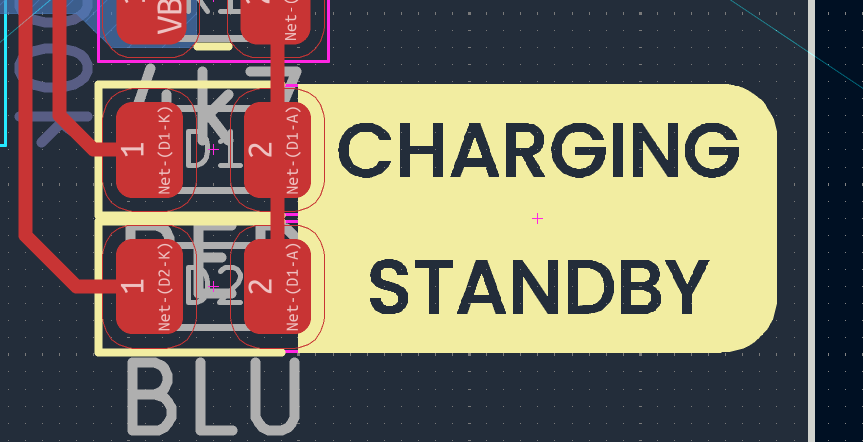
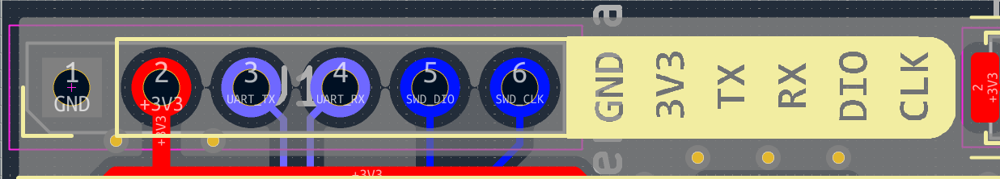
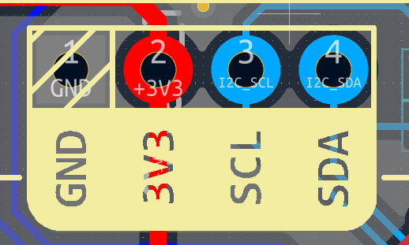
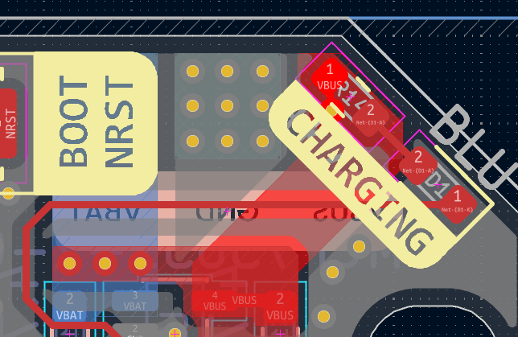
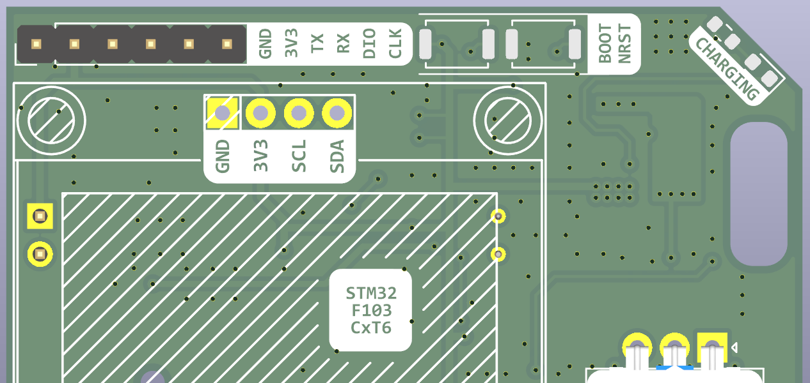

# PCB Silkscreen Knockout Generator

A browser-based tool for generating boxed, "knocked-out" PCB silkscreen labels in
real millimetres. It exports a high-DPI PNG for **KiCad's Image Converter**
(bitmap2component), or writes a `.kicad_mod` footprint directly.

## Features

- **Configurable labels** — add/remove/reorder, per-label text, enable & box toggles.
- **Precise layout** — pitch (e.g. 2.54 mm), row/column arrangement, orientation, alignment
  (left/center/right × top/middle/bottom).
- **Graphics-based alignment** — aligns on the actual glyph ink, not font advance metrics.
- **Real cap-height sizing** — measures each font's cap-height ratio, so a "1.2 mm" label really
  is 1.2 mm tall on the board (instead of assuming a fixed 0.72 ratio).
- **Box / Plate** — per-label boxes, or a single "plate" one-big-box with individually
  roundable corners (e.g. two of four rounded).
- **Colors + alpha** — box, board, and text colors each with opacity, exported as RGBA PNG.
- **Custom fonts** — upload a `.ttf`/`.otf`/`.woff`; persists across reloads.
- **Precise sizing** — set the plate/canvas size in mm; the output matches what you measure.
- **High-resolution PNG** — export at high DPI (default 2400) with quality presets; only the
  aspect ratio matters because KiCad sets the physical size.
- **Auto-named export** — the downloaded PNG or `.kicad_mod` is named from the labels' text
  (e.g. `VBUS_GND.png`, `VBUS_GND.kicad_mod`).
- **JLCPCB-aware** — a live compliance panel measures the rendered glyph height, stroke width,
  character gaps and knockout ink walls against the
  [JLCPCB character design specifications](https://jlcpcb.com/blog/character-design-specifications).
  It supports the standard and high-precision processes, checks export resolution, and can clamp
  the design to JLCPCB's recommended values.
- **Direct KiCad footprint** — generates a `.kicad_mod` (img2mod-style) and lets you **download**
  it or **copy** the footprint text to the clipboard, without the Image Converter step.

## JLCPCB compliance

The **JLCPCB spec** panel in the sidebar measures the real rendered geometry and reports
hard failures (red), missed recommendations (amber), and board-specific checks that can only be
done in KiCad (notes).

| Check | Standard silkscreen | High-precision characters |
| --- | --- | --- |
| Character height (cap height) | ≥ 1.00 mm | ≥ 0.80 mm |
| Character stroke | ≥ 0.15 mm | ≥ 0.10 mm |
| Character / ink gap | ≥ 0.15 mm (0.20 mm recommended) | same |
| Export resolution | ≥ 4 px on the narrowest feature | same |

How it is measured:

- **Height** uses the font's measured cap-height ratio (`H` ascent), not a fixed guess.
- **Stroke** is measured from the rasterised glyphs. If the font's own stem is thinner than the
  **Stroke target**, the renderer adds a thin outline to reach it and the panel reports the
  measured result.
- **Gaps** are measured from the rendered glyphs, including **Letter spacing**.
- **Ink walls** are measured from the box edge (or plate edge) to the glyph ink — this is the
  thin silkscreen ring that survives around a knocked-out letter.
- **Export resolution** checks how many pixels the narrowest feature gets at the chosen DPI.
- **Plate clipping** catches a fixed-size plate whose canvas would crop the labels.

**Apply recommended values** clamps height, stroke, box padding, plate margin and DPI to the
recommended values. When a hard limit is exceeded, the **KiCad-black** PNG export asks for
confirmation first (toggleable), because JLCPCB may otherwise widen or remove the affected
silkscreen.

High-precision characters are a separate process option when ordering. Use the **Standard**
profile unless you have selected that option.

### Pad and exposed-copper clearance

The tool only knows about the labels, not your board. JLCPCB removes silkscreen that overlaps
exposed copper/pads or sits within 0.15 mm of a pad. After placing the exported graphic in KiCad:

- run DRC with a silkscreen-to-pad clearance of ≥ 0.25 mm for best yield,
- keep labels off exposed copper and pads,
- if a label must overlap a pad, state it in the order remarks.

Use simple, solid-stroke fonts where possible. Hollow/outlined fonts need ≥ 0.20 mm strokes and
≥ 1.5 mm height, and decorative fonts are more likely to need larger minimums. Manufacturing
capabilities can change — re-check the linked JLCPCB page before ordering.

## Direct KiCad footprints (img2mod)

The **KiCad footprint** panel converts the current knockout artwork straight into a `.kicad_mod`
footprint — no Image Converter step. It is a TypeScript reimplementation of the
[img2mod](http://img2mod.wayneandlayne.com/) approach (the GPLv2 reference script is included in
`img2mod/`; the original is by Matthew Beckler, Wayne and Layne, LLC).

- **Pixel size** sets the physical size of one bitmap pixel (default 0.025 mm).
- **Side** places the polygons on `F.SilkS` or `B.SilkS` and sets the footprint layer accordingly.
- **Center at footprint origin** puts the artwork's centre at `(0, 0)`; otherwise it starts at 0,0.
- **Download** saves `NAME.kicad_mod`. **Copy** copies the same text to the clipboard.
- Adjacent pixel runs are merged into rectangles, so the output covers exactly the same area as
  img2mod's one-polygon-per-pixel output but is much smaller.
- The file uses footprint format version `20211014` (KiCad 6 and newer). Polygons are filled
  silkscreen shapes with a 0.01 mm outline to avoid hairline seams.

The footprint is tightly cropped (the PNG margin is ignored) and honours the current
**Capture → Single label** setting. Smaller pixels give smoother curves but more polygons and a
larger file; the panel reports the polygon count, size, and dimensions after generation. For
text-heavy designs the PNG + Image Converter path can produce smoother curves; the direct
footprint export is ideal for logos, QR codes, and pixel-style art.

## Examples

Some of the silkscreen looks generated with the tool:

| Example 1 | Example 2 |
| :-: | :-: |
|  |  |

| Example 3 | Example 4 | Example 5 |
| :-: | :-: | :-: |
|  |  |  |

## Usage

1. `npm install`
2. `npm run dev` — open http://localhost:5173
3. Configure labels/layout/colors. Resolve any red **JLCPCB spec** findings (or click
   **Apply recommended values**), then **⬇ Download PNG**.
4. In KiCad: **Image Converter** → choose the PNG → `F.Silkscreen`, Front → set the scale so
   the canvas maps to the **Box** size shown in the Export panel. Run DRC to confirm the
   silkscreen is clear of pads and exposed copper.

Alternatively, skip the Image Converter: use the **KiCad footprint** panel to **Download** a
`.kicad_mod`, or **Copy** the footprint text and paste it into a new file in a `.pretty` footprint
library. It uses the current artwork and `Capture` setting.

## Scripts

- `npm run dev` — start the dev server
- `npm run build` — type-check and build for production
- `npm test` — run the unit tests (vitest)
- `npm run preview` — preview the production build

## Stack

Vite · React · TypeScript (frontend only, no backend).
